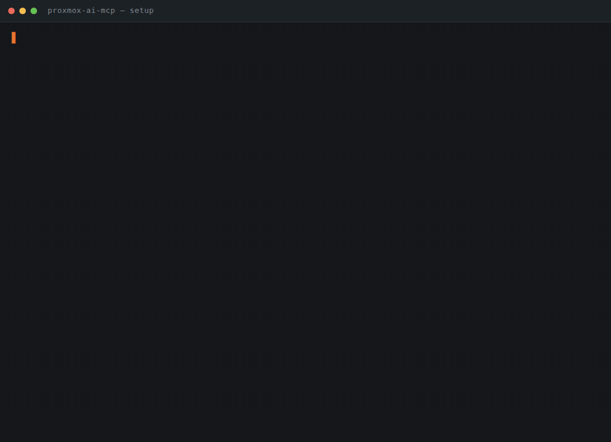
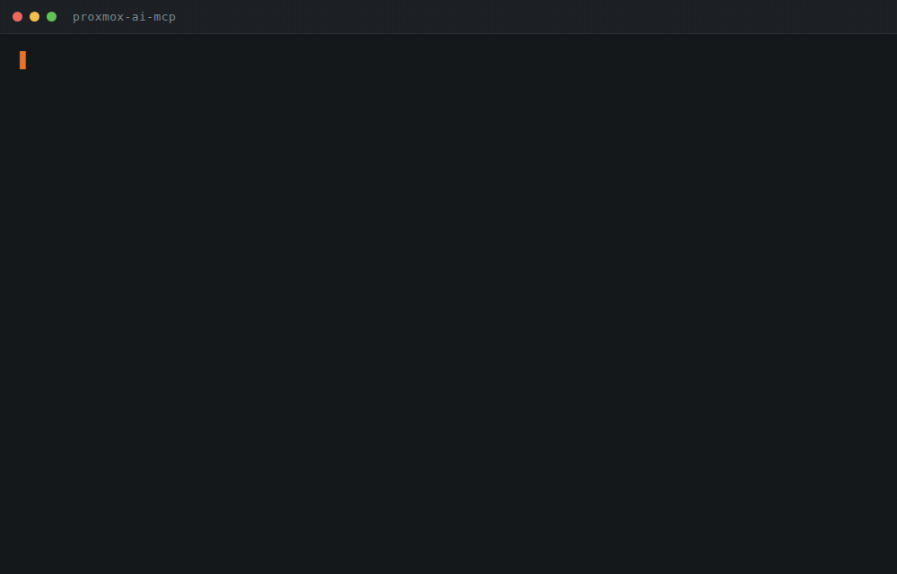

# proxmox-ai-mcp

Give your AI client — **Codex CLI, Qwen Code, Claude Code, DeepSeek CLI, Cursor, Claude Desktop,
Windsurf, Gemini CLI, VS Code** — real tools for your Proxmox VE infrastructure, through the
[Proxmox AI](https://proxmox.ai.id) platform.

> What is the platform? → **[PLATFORM.md](PLATFORM.md)**

## Quick start

One command, on any machine, whichever agent you use. **Claude Code is not required** — it is one
choice among several, and a machine with no agent at all is the case this is built for:

```sh
curl -fsSL https://proxmox.ai.id/install-agent.sh | sh
```

That is the whole thing. It asks for your key rather than making you fit one on a command line,
and if the machine has no AI agent yet it asks which to install:

```
This machine has no AI agent yet. Which one should I install?

  1) Claude Code   — Anthropic account
  2) Codex CLI     — OpenAI account
  3) Qwen Code     — Qwen or any OpenAI-compatible account
  4) none          — just set up the Proxmox tools
```

Then it registers the MCP server with every agent on the machine — Claude Code included — links the
`pmx` shell client onto your `PATH`, installs the skill, and offers to run the agent's sign-in there
and then. Three answers — which agent, your key, your model account —
and nothing is left to do. A machine that already has its agents skips the first question.

Pass `--key pak_…` to skip being asked, which is what a script wants.

Setting up several machines at once? `--agent codex` answers it ahead of time, and `--agent none`
declines. The agent installs under `~/.proxmox-ai/agents` and is linked onto your `PATH`: nothing
outside `~/.proxmox-ai` is touched and no package manager runs as root.

**Each agent signs in to its own model account.** This installer supplies infrastructure tools and
never model credentials. Your Proxmox key decides which tools the agent sees; your Anthropic,
OpenAI or Qwen account pays for the model. Neither stands in for the other.

### Rather read it first

Fair. It is the file in this repo, so read it here or download it:

```sh
curl -fsSL -o install-agent.sh https://proxmox.ai.id/install-agent.sh
less install-agent.sh               # ~260 lines of POSIX shell, same file as this repo's
sh install-agent.sh --key pak_xxxxxxxxxxxx_…
```

It fetches this repo into `~/.proxmox-ai/src`, checks the key against the platform before writing
anything, supplies Node when the machine has none, and then sets up whichever path the machine can
run: with Node a real MCP server, without Node the `pmx` shell command instead. Add `--url` if you
self-host, `--curl-only` to skip the MCP server, and `--device` for a key pinned to machines.



### In Claude Code there is also a plugin

The one-liner above already sets Claude Code up. The plugin is the other route: it asks for the key
itself, keeps it out of every file, adds the `/pmx-ai` command on top of the MCP server, and nothing
is downloaded by a shell.

```
/plugin marketplace add hamimistimewa/proxmox-ai-mcp
/plugin install proxmox-ai
```

This is an alternative to the one-liner above, not a prerequisite for it.

Claude Code asks for your API key when you enable it and keeps it in the platform's secure
credential store — the key is never written into a config file, and the plugin never reads a
credential that was already in your environment. Issue the key in your dashboard under **API keys**;
its role decides which tools appear.

Then ask for whatever you need in plain language:

```
/pmx-ai which node has the least headroom right now
/pmx-ai create an ubuntu 24.04 VM on the quietest node
/pmx-ai generate this week's report
/pmx-ai why is VM 101 slow
```

The model answers in whatever language you ask in — `/pmx-ai berapa RAM yang kepakai di node lab`
works the same way. Anything that changes infrastructure comes back as a plan with its warnings, and
waits for you to confirm it; nothing runs before that.

*One command, then `claude mcp list` to confirm. Asking for a VM gets you a plan and a warning — and
it stops there, at `proposed`, until a human confirms it.*

---

Prefer to do it by hand? Two ways in. Both are thin clients; the role check, the validation and the
guardrail live on the platform.

| | Needs | Good for |
| --- | --- | --- |
| **A · Shell + curl** | `curl` only | anything that can run a shell: Claude Code, Codex, a terminal. Nothing to install. |
| **B · MCP server** | Node 20+ | first-class tools in the client's tool list — Claude Desktop, Cursor, Windsurf |



*Ask for a health check, then ask for a VM in plain language. The change stops at a plan until you confirm it.*

## A · Shell + curl (no Node)

```sh
git clone https://github.com/hamimistimewa/proxmox-ai-mcp
cd proxmox-ai-mcp
./install.sh --url https://proxmox.ai.id --key pak_xxxxxxxxxxxx_…
```

That checks the key, saves it to `~/.proxmox-ai/config.json` (mode `600`), links `pmx` onto your `PATH`, and
drops the skill into `~/.claude/skills/` and `~/.codex/skills/` where those exist. Then just talk to your
agent — it has a shell, and now it has `pmx`:

> node mana yang RAM-nya paling mepet?

`pmx` is one POSIX shell script with no dependency beyond `curl`. Read it: `server/pmx`.

```sh
pmx me                                  # who this key is, which role, which organization
pmx tools                               # exactly what this key is allowed to call
pmx get /nodes                          # the fleet
pmx get /nodes/pve01/usage range=24h    # one node, with history
pmx get /vms                            # guests and templates
pmx get /guests/101                     # one guest in detail
pmx get /backups/overview               # last backup per guest — finds the gaps
pmx get /audit limit=20                 # who changed what, agents included
pmx actions                             # proposals waiting, recent results
pmx propose guest_power vmid=101 operation=shutdown
pmx confirm 42                          # only after a human read the plan
pmx cancel 42
```

Raw `curl` works exactly the same, if you would rather see it:

```sh
curl -sS -H "Authorization: Bearer pak_…" https://proxmox.ai.id/api/v1/nodes
```

## B · MCP server (Node 20+)

```sh
node server/install.mjs --url https://proxmox.ai.id --key pak_xxxxxxxxxxxx_…
```

Same checks, then it registers this server with every AI client it finds and installs the skill. Restart the
client and the Proxmox tools are in its tool list. No dependencies, nothing to build — the whole JSON-RPC
protocol is written out in `server/proxmox-ai-mcp.mjs` so you can read it in one sitting.

---

## The point: your API key decides the tools

Neither client ships a tool list of its own. Both ask the platform which tools **this key** may use:

| Key role | What the agent sees |
| --- | --- |
| `readonly` | nodes, guests, storage, backups, reports, audit — read only |
| `operator` | the above, plus `propose_action`, `confirm_action`, `cancel_action` |
| `superadmin` | the above, plus connections, backup servers, alerts, team |
| platform key | organizations, hosts, vRouters, estate-wide overview |

```console
$ pmx tools        # operator key
scope: organization  role: operator  org: Acme
  whoami           GET  /me
  list_nodes       GET  /nodes
  propose_action   POST /actions
  confirm_action   POST /actions/{id}/confirm
  …55 tools

$ pmx tools        # readonly key
  …49 tools, and propose_action is not among them
```

A readonly key is never *told* that `propose_action` exists, so the model cannot try it and be refused — the
tool is simply absent. IP whitelist, rate limit and expiry are still enforced by the platform on every call.

It also means the tools stay current: add an endpoint on the platform and every installed copy picks it up on
its next run. You do not pull this repository again.

## Guided workflows, not just tools

The server also publishes **prompts** — ops workflows that already know which tools to call, in what order,
and what to report. In Claude Code they appear as slash commands.

| Prompt | What it does |
| --- | --- |
| `health-check` | Walks the fleet: node pressure, failed tasks, guests with no recent backup |
| `capacity-review` | Headroom per node, which resource runs out first, and roughly when |
| `backup-audit` | Unprotected guests, failing jobs, datastores a node cannot reach |
| `exposure-review` | What the vRouter exposes to the internet, and whether it should |
| `triage` | Starts from a symptom and narrows it with live data instead of guessing |
| `plan-vm` | Picks node and template from real options, then leaves a proposal to confirm |
| `explain-action` | Reads a pending proposal and explains what it changes and what is hard to undo |

```console
> /mcp__proxmox-ai__health-check
> /mcp__proxmox-ai__triage symptom="web-01 is slow since this morning"
```

Prompts follow the key too: `plan-vm` needs `propose_action`, so a readonly key is offered six prompts,
an operator seven. None of them confirms anything — every one ends by telling the model to stop at a plan.

**Resources** expose the same data as context the client can pull in without spending a tool call:
`proxmox://me`, `proxmox://nodes`, `proxmox://guests`, `proxmox://storage`, `proxmox://actions`,
`proxmox://backups`.

## One server for several people

```sh
proxmox-ai-mcp --transport http --port 8080
```

Serves streamable HTTP on `POST /mcp` and a readiness check on `GET /health`. Each request carries its own
key, so one server can serve a whole team and each person still sees only the tools their key allows:

```sh
curl -sS -X POST http://localhost:8080/mcp \
  -H "Authorization: Bearer pak_…" -H 'content-type: application/json' \
  -d '{"jsonrpc":"2.0","id":1,"method":"tools/list"}'
```

It opens no SSE stream: every answer comes back on the POST that asked for it. Point a client at it with
`npx mcp-remote http://host:8080/mcp`, or run it from the image:

```sh
docker build -t proxmox-ai-mcp .
docker run --rm -p 8080:8080 -e PROXMOX_AI_TRANSPORT=http \
  -e PROXMOX_AI_URL=https://proxmox.ai.id proxmox-ai-mcp
```

## Changes always stop for a human

```
pmx propose …   →  validated against live Proxmox state, returns a plan and warnings — nothing changed
                     ↓
                   a human reads the plan and decides
                     ↓
pmx confirm 42  →  it runs, in the background, recorded in the audit log
```

High-risk actions (erasing a disk, destroying a guest, rebooting a node) additionally require the exact
`typed_confirmation` string from the plan. Organizations can switch on four-eyes, requiring a different
person to confirm. Proposals expire after 15 minutes.

The bundled skill is what teaches the model that discipline — tool descriptions alone do not.

---

## What gets written where

| File | Contents |
| --- | --- |
| `~/.proxmox-ai/config.json` | your platform URL, API key and this machine's id, mode `600` |
| `~/.local/bin/pmx` | symlink to `server/pmx`, on both paths — or `/usr/local/bin` when that is the one already on your `PATH` |
| `~/.claude/skills/proxmox-operations/`, `~/.codex/skills/proxmox-operations/` | the shell skill, copied from `cli-skill/SKILL.md` |
| `~/Library/Application Support/Claude/claude_desktop_config.json` | Claude Desktop (`~/.config/Claude/` on Linux, `%APPDATA%` on Windows) |
| `~/.codex/config.toml` | Codex CLI, as `[mcp_servers.proxmox_ai]` |
| `~/.cursor/mcp.json`, `~/.codeium/windsurf/mcp_config.json`, `~/.gemini/settings.json`, `~/.qwen/settings.json` | Cursor, Windsurf, Gemini CLI, Qwen Code |
| `~/.weiping-whale/config.toml` | DeepSeek CLI, as `[mcp_servers.proxmox_ai]` (the older `~/.deepseek-cli/` is honoured too) |
| `~/.codex/skills/`, `~/.weiping-whale/skills/` | the skill, for the agents that scan their own skills directory |

**The key is never written into a client's config** — those only get a path. Your dotfiles stay safe to
commit. Clients that are not installed are skipped; existing entries are merged, never overwritten.

Claude Code is in that list like any other client. It was left out for a while, on the reasoning
that the plugin is the better route there — but the plugin asks for its own key and reads nothing
from disk, so the two never touched, and leaving it out only meant a machine where every other agent
got its tools and Claude Code got the skill with nothing to call. The plugin remains the better
route when you would rather no file held the key at all; see **Credentials & privacy** below.

## Installing the agent as well

Covered in [Quick start](#quick-start): the one-liner asks which agent to install when the machine
has none, and `--agent claude|codex|qwen|none` answers ahead of time.

Three agents install this way, each verified against its published package: Claude Code
(`@anthropic-ai/claude-code`), Codex CLI (`@openai/codex`) and Qwen Code (`@qwen-code/qwen-code`).
DeepSeek CLI is set up when it is already on the machine, but it is not offered for installation:
its package is not published to npm and has to be built from source.

## Two skills, two ways in

The plugin ships exactly one skill, `skills/proxmox-operations/`, which drives the MCP tools.

`cli-skill/SKILL.md` is not a plugin skill and is deliberately outside `skills/` so Claude Code
never loads it. It is the template `install.sh` copies onto a machine that has no MCP server, where
the `pmx` shell command is the way in. Shipping it as a plugin skill would tell a model to run `pmx`,
which a plugin install does not put on the PATH.

## Credentials & privacy

There are two ways in, and they keep their credentials apart.

**As a Claude Code plugin.** The key is a `userConfig` field marked `sensitive`, so Claude Code prompts
for it and holds it in its own credential store. `.mcp.json` hands it to the server as
`${user_config.api_key}` together with `PROXMOX_AI_PLUGIN=1`, and in that mode the server reads the key
from that handshake and nowhere else — it opens no config file, honours no path override, and ignores
any `PROXMOX_AI_KEY` you may have set in your shell for something else. Nothing is written to disk.

**As the standalone CLI**, for Claude Desktop, Cursor, Windsurf, Gemini CLI, Codex, Docker, or the `pmx`
shell command. These clients have no such prompt, so `install.sh` stores the key in
`~/.proxmox-ai/config.json` with mode `600` after verifying it. That file is the only place this project
ever writes a credential, and the MCP plugin never reads it.

**A key pinned to machines** works on every path — the MCP server, the plugin, and the `pmx`
command. The identifier that says which machine this is
carries no secret and grants nothing on its own — an unrecognised one appears in the dashboard as a
machine awaiting your approval. The CLI keeps it in `~/.proxmox-ai/config.json` beside the key; the
plugin keeps it in its own `${CLAUDE_PLUGIN_DATA}` directory, so plugin mode still reads nothing of
yours. Pin a key to machines instead of IP addresses when you work from changing networks.

Either way:

- The key travels to one host only: the platform URL you configured, `https://proxmox.ai.id` unless you
  self-host. Grep the repo — it is the only URL in it.
- No telemetry, no analytics, no third-party endpoint, and no dependencies that could add one: the
  `dependencies` field in `package.json` is empty.
- The key is never logged. Errors name the key as a *thing* to check; none of them print its value.
- Nothing is sent to any AI vendor by this project. Your AI client talks to its own provider as it
  always does; this server only answers that client over stdio.
- Revoke a key in the dashboard under **Organization → API keys** and it stops working immediately —
  no uninstall needed. For the CLI, delete `~/.proxmox-ai/config.json`.

## Getting a key

Dashboard → **Organization → API keys**. Pick the lowest role that does the job, list the IP addresses it
will be used from (required), and set an expiry. The key is shown once.

Start with `readonly`. Move to `operator` when you want the agent to draft changes for you — it still
cannot execute them.

## Troubleshooting

| Message | Meaning |
| --- | --- |
| `cannot be used from …` | your current IP is not on the key's whitelist |
| `This needs the Operator role or higher` | the key's role is too low — issue a new key, do not retry |
| `did not return a tool manifest` | the URL does not point at a Proxmox AI platform |
| `pmx: no configuration` | re-run the installer, or set `PROXMOX_AI_URL` and `PROXMOX_AI_KEY` |
| `install-agent.sh: --key is required` | the one-liner needs `sh -s --` before the flags, or they reach `sh` instead of the script |
| `Send the API key as "Authorization: Bearer …"` | HTTP transport with no key on the request and none configured |
| no tools in the client | restart it; MCP config is read at start-up |

Re-running any of the three installers is safe: each verifies the key against the platform before it
writes anything, and a second run only rotates what changed.

## Licence

MIT · by **Nur Hamim** · [nurhamim.com](https://nurhamim.com)

## About the name

Proxmox® is a trademark of Proxmox Server Solutions GmbH. This is an independent, community-built
client for Proxmox VE and is **not affiliated with, endorsed by, or sponsored by** Proxmox Server
Solutions GmbH. It talks to a Proxmox VE installation through the Proxmox AI platform's own API.

Licensed MIT — see [LICENSE](LICENSE).
