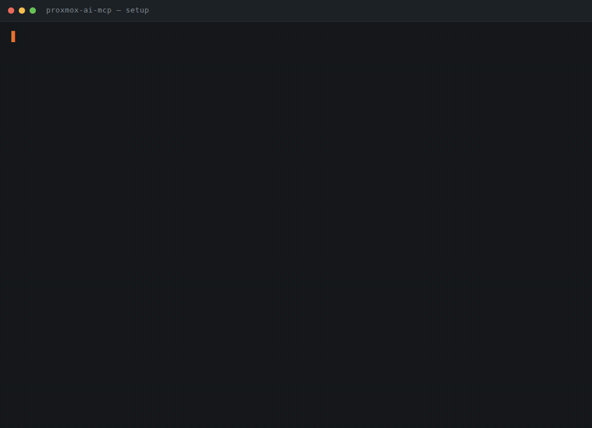
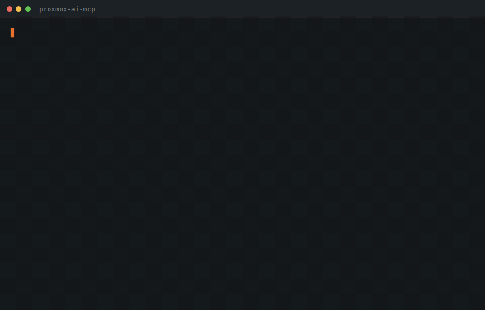

# proxmox-ai-mcp

Give your AI client — **Claude Code, Codex, Claude Desktop, Cursor** — real tools for your Proxmox VE
infrastructure, through the [Proxmox AI](https://proxmox.ai.id) platform.

> What is the platform? → **[PLATFORM.md](PLATFORM.md)**

## Quick start

### In Claude Code

Install it as a plugin and let Claude Code ask for your key — nothing is downloaded by a shell:

```
/plugin install proxmox-ai --marketplace hamimistimewa/proxmox-ai-mcp
```

### Anywhere else

Download the installer, read it, then run it:

```sh
curl -fsSL -o proxmox-ai-install.sh https://proxmox.ai.id/mcp.sh
less proxmox-ai-install.sh          # it is ~120 lines of POSIX shell
sh proxmox-ai-install.sh --key pak_xxxxxxxxxxxx_…
```

<details>
<summary>One-liner, if you would rather not read it first</summary>

```sh
curl -fsSL https://proxmox.ai.id/mcp.sh | sh -s -- --key pak_xxxxxxxxxxxx_…
```

Piping a remote script into a shell runs code nobody has looked at. The two-step form above is the
same installer with a chance to read it first.
</details>

It fetches this repo into `~/.proxmox-ai/src`, checks the key against the platform before writing
anything, and then sets up whichever path your machine can run: with Node it registers a real MCP
server with every AI client it finds; without Node it installs the `pmx` command instead. Add
`--url` if you self-host, and `--curl-only` to skip the MCP server.



### In Claude Code

This repo is also a Claude Code plugin, which adds the `/pmx-ai` command on top of the MCP server:

```
/plugin install proxmox-ai --marketplace hamimistimewa/proxmox-ai-mcp
```

Claude Code asks for your API key when you enable it and keeps it in the platform's secure
credential store — the key is never written into a config file, and the plugin never reads a
credential that was already in your environment. Issue the key in your dashboard under **API keys**;
its role decides which tools appear.

Then ask for whatever you need in plain language:

```
/pmx-ai which node has the least headroom right now
/pmx-ai create an ubuntu 24.04 VM on the quietest node
/pmx-ai generate this week's report
/pmx-ai why is VM 101 slow
```

The model answers in whatever language you ask in — `/pmx-ai berapa RAM yang kepakai di node lab`
works the same way. Anything that changes infrastructure comes back as a plan with its warnings, and
waits for you to confirm it; nothing runs before that.

*One command, then `claude mcp list` to confirm. Asking for a VM gets you a plan and a warning — and
it stops there, at `proposed`, until a human confirms it.*

---

Prefer to do it by hand? Two ways in. Both are thin clients; the role check, the validation and the
guardrail live on the platform.

| | Needs | Good for |
| --- | --- | --- |
| **A · Shell + curl** | `curl` only | anything that can run a shell: Claude Code, Codex, a terminal. Nothing to install. |
| **B · MCP server** | Node 20+ | first-class tools in the client's tool list — Claude Desktop, Cursor, Windsurf |



*Ask for a health check, then ask for a VM in plain language. The change stops at a plan until you confirm it.*

## A · Shell + curl (no Node)

```sh
git clone https://github.com/hamimistimewa/proxmox-ai-mcp
cd proxmox-ai-mcp
./install.sh --url https://proxmox.ai.id --key pak_xxxxxxxxxxxx_…
```

That checks the key, saves it to `~/.proxmox-ai/config.json` (mode `600`), links `pmx` onto your `PATH`, and
drops the skill into `~/.claude/skills/` and `~/.codex/skills/` where those exist. Then just talk to your
agent — it has a shell, and now it has `pmx`:

> node mana yang RAM-nya paling mepet?

`pmx` is one POSIX shell script with no dependency beyond `curl`. Read it: `server/pmx`.

```sh
pmx me                                  # who this key is, which role, which organization
pmx tools                               # exactly what this key is allowed to call
pmx get /nodes                          # the fleet
pmx get /nodes/pve01/usage range=24h    # one node, with history
pmx get /vms                            # guests and templates
pmx get /guests/101                     # one guest in detail
pmx get /backups/overview               # last backup per guest — finds the gaps
pmx get /audit limit=20                 # who changed what, agents included
pmx actions                             # proposals waiting, recent results
pmx propose guest_power vmid=101 operation=shutdown
pmx confirm 42                          # only after a human read the plan
pmx cancel 42
```

Raw `curl` works exactly the same, if you would rather see it:

```sh
curl -sS -H "Authorization: Bearer pak_…" https://proxmox.ai.id/api/v1/nodes
```

## B · MCP server (Node 20+)

```sh
node server/install.mjs --url https://proxmox.ai.id --key pak_xxxxxxxxxxxx_…
```

Same checks, then it registers this server with every AI client it finds and installs the skill. Restart the
client and the Proxmox tools are in its tool list. No dependencies, nothing to build — the whole JSON-RPC
protocol is written out in `server/proxmox-ai-mcp.mjs` so you can read it in one sitting.

---

## The point: your API key decides the tools

Neither client ships a tool list of its own. Both ask the platform which tools **this key** may use:

| Key role | What the agent sees |
| --- | --- |
| `readonly` | nodes, guests, storage, backups, reports, audit — read only |
| `operator` | the above, plus `propose_action`, `confirm_action`, `cancel_action` |
| `superadmin` | the above, plus connections, backup servers, alerts, team |
| platform key | organizations, hosts, vRouters, estate-wide overview |

```console
$ pmx tools        # operator key
scope: organization  role: operator  org: Acme
  whoami           GET  /me
  list_nodes       GET  /nodes
  propose_action   POST /actions
  confirm_action   POST /actions/{id}/confirm
  …53 tools

$ pmx tools        # readonly key
  …48 tools, and propose_action is not among them
```

A readonly key is never *told* that `propose_action` exists, so the model cannot try it and be refused — the
tool is simply absent. IP whitelist, rate limit and expiry are still enforced by the platform on every call.

It also means the tools stay current: add an endpoint on the platform and every installed copy picks it up on
its next run. You do not pull this repository again.

## Guided workflows, not just tools

The server also publishes **prompts** — ops workflows that already know which tools to call, in what order,
and what to report. In Claude Code they appear as slash commands.

| Prompt | What it does |
| --- | --- |
| `health-check` | Walks the fleet: node pressure, failed tasks, guests with no recent backup |
| `capacity-review` | Headroom per node, which resource runs out first, and roughly when |
| `backup-audit` | Unprotected guests, failing jobs, datastores a node cannot reach |
| `exposure-review` | What the vRouter exposes to the internet, and whether it should |
| `triage` | Starts from a symptom and narrows it with live data instead of guessing |
| `plan-vm` | Picks node and template from real options, then leaves a proposal to confirm |
| `explain-action` | Reads a pending proposal and explains what it changes and what is hard to undo |

```console
> /mcp__proxmox-ai__health-check
> /mcp__proxmox-ai__triage symptom="web-01 is slow since this morning"
```

Prompts follow the key too: `plan-vm` needs `propose_action`, so a readonly key is offered six prompts,
an operator seven. None of them confirms anything — every one ends by telling the model to stop at a plan.

**Resources** expose the same data as context the client can pull in without spending a tool call:
`proxmox://me`, `proxmox://nodes`, `proxmox://guests`, `proxmox://storage`, `proxmox://actions`,
`proxmox://backups`.

## One server for several people

```sh
proxmox-ai-mcp --transport http --port 8080
```

Serves streamable HTTP on `POST /mcp` and a readiness check on `GET /health`. Each request carries its own
key, so one server can serve a whole team and each person still sees only the tools their key allows:

```sh
curl -sS -X POST http://localhost:8080/mcp \
  -H "Authorization: Bearer pak_…" -H 'content-type: application/json' \
  -d '{"jsonrpc":"2.0","id":1,"method":"tools/list"}'
```

It opens no SSE stream: every answer comes back on the POST that asked for it. Point a client at it with
`npx mcp-remote http://host:8080/mcp`, or run it from the image:

```sh
docker build -t proxmox-ai-mcp .
docker run --rm -p 8080:8080 -e PROXMOX_AI_TRANSPORT=http \
  -e PROXMOX_AI_URL=https://proxmox.ai.id proxmox-ai-mcp
```

## Changes always stop for a human

```
pmx propose …   →  validated against live Proxmox state, returns a plan and warnings — nothing changed
                     ↓
                   a human reads the plan and decides
                     ↓
pmx confirm 42  →  it runs, in the background, recorded in the audit log
```

High-risk actions (erasing a disk, destroying a guest, rebooting a node) additionally require the exact
`typed_confirmation` string from the plan. Organizations can switch on four-eyes, requiring a different
person to confirm. Proposals expire after 15 minutes.

The bundled skill is what teaches the model that discipline — tool descriptions alone do not.

---

## What gets written where

| File | Contents |
| --- | --- |
| `~/.proxmox-ai/config.json` | your platform URL and API key, mode `600` |
| `~/.local/bin/pmx` | symlink to `server/pmx` (shell path) |
| `~/.claude/skills/proxmox-operations/`, `~/.codex/skills/proxmox-operations/` | the skill |
| `~/.claude.json` | Claude Code: a path to the MCP server |
| `~/Library/Application Support/Claude/claude_desktop_config.json` | Claude Desktop (`~/.config/Claude/` on Linux, `%APPDATA%` on Windows) |
| `~/.codex/config.toml` | Codex CLI, as `[mcp_servers.proxmox_ai]` |
| `~/.cursor/mcp.json`, `~/.codeium/windsurf/mcp_config.json`, `~/.gemini/settings.json` | Cursor, Windsurf, Gemini CLI |

**The key is never written into a client's config** — those only get a path. Your dotfiles stay safe to
commit. Clients that are not installed are skipped; existing entries are merged, never overwritten.

## Using it from the OpenAI API instead

```sh
node server/export-openai-tools.mjs --url https://proxmox.ai.id --key pak_…   # → schemas/openai-tools.json
pip install openai && python examples/openai_client.py "ringkas kondisi infrastruktur saya"
```

Generated from the same manifest, so it is filtered by your key's role in exactly the same way.

## Getting a key

Dashboard → **Organization → API keys**. Pick the lowest role that does the job, list the IP addresses it
will be used from (required), and set an expiry. The key is shown once.

Start with `readonly`. Move to `operator` when you want the agent to draft changes for you — it still
cannot execute them.

## Troubleshooting

| Message | Meaning |
| --- | --- |
| `cannot be used from …` | your current IP is not on the key's whitelist |
| `This needs the Operator role or higher` | the key's role is too low — issue a new key, do not retry |
| `did not return a tool manifest` | the URL does not point at a Proxmox AI platform |
| `pmx: no configuration` | re-run the installer, or set `PROXMOX_AI_URL` and `PROXMOX_AI_KEY` |
| `mcp.sh: --key is required` | the one-liner needs `sh -s --` before the flags, or they reach `sh` instead of the script |
| `Send the API key as "Authorization: Bearer …"` | HTTP transport with no key on the request and none configured |
| no tools in the client | restart it; MCP config is read at start-up |

Re-running any of the three installers is safe: each verifies the key against the platform before it
writes anything, and a second run only rotates what changed.

## Licence

MIT · by **Nur Hamim** · [nurhamim.com](https://nurhamim.com)

## About the name

Proxmox® is a trademark of Proxmox Server Solutions GmbH. This is an independent, community-built
client for Proxmox VE and is **not affiliated with, endorsed by, or sponsored by** Proxmox Server
Solutions GmbH. It talks to a Proxmox VE installation through the Proxmox AI platform's own API.

Licensed MIT — see [LICENSE](LICENSE).
